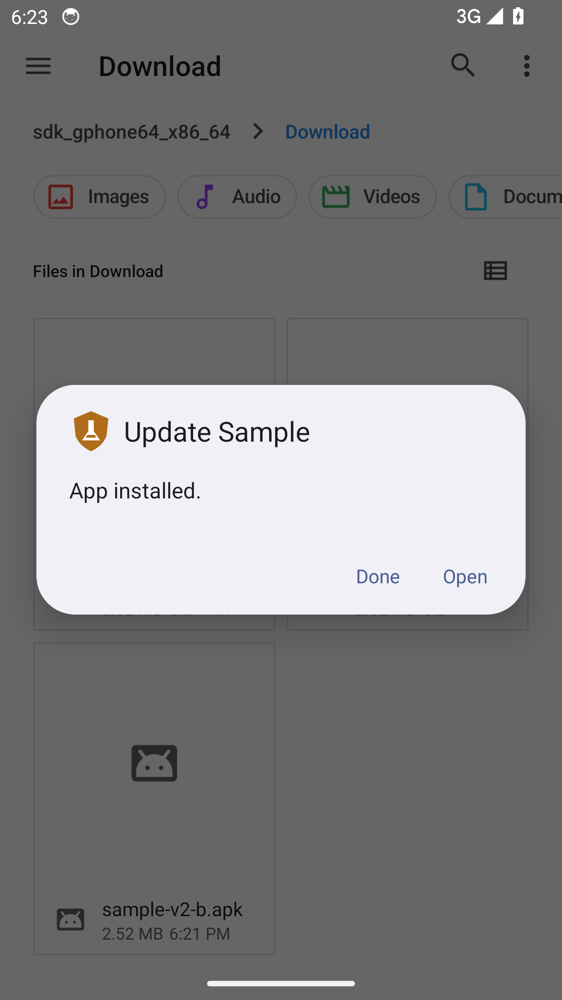
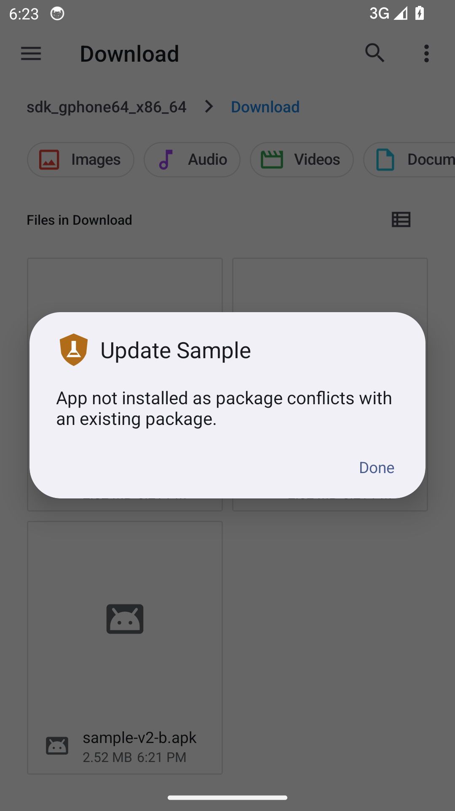
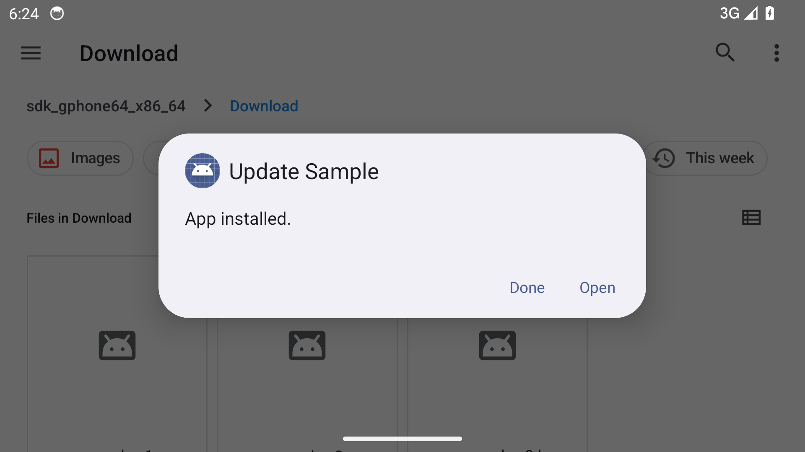

# Исследование встроенных механизмов безопасности Android 14

## Введение

Цель работы — выяснить, как Android 14 контролирует обновление приложений, установку из сторонних источников и доступ к микрофону, и какие решения системы видит пользователь. Дополнительно исследуется доступность настройки USB-отладки. Экспериментальная среда — эмулятор Google APIs x86_64, API 34, профиль Pixel 2, запущенный в GitHub Actions. Англоязычные сообщения системы сохраняются в оригинале. [Инструкция по запуску](docs/RUN.md)

## 1. Проверка цифровой подписи APK

При обновлении Android проверяет совместимость подписи нового APK с уже установленным пакетом. Во всех трёх опытах использован пакет `ru.securitylab.sample`. У двух APK версии 2 совпадают манифест, программный код и остальные элементы архива. Обновления различаются ключами подписи. Использованы независимые сертификаты A и B без ротации ключей.

### 1.1. Первая установка

На чистом эмуляторе через системное приложение «Файлы» открыли APK версии 1, подписанный ключом A, и подтвердили установку.

**PASS.** Установщик сообщил «App installed.». Package Manager зарегистрировал версию 1. Хеш установленного APK совпал с хешем исходного файла.

### 1.2. Попытка обновления с сертификатом B

Поверх версии 1 предложили версию 2 с другим сертификатом. Номер версии увеличивался, поэтому понижение версии исключено.

**PASS.** Установщик сообщил «App not installed as package conflicts with an existing package.». Package Manager указал на несовместимость подписей. После отказа сохранились версия 1 и хеш установленного APK.

### 1.3. Обновление с сертификатом A

Для повторной попытки использовали версию 2 с исходной подписью A.

**PASS.** Установщик сообщил «App installed.». Переход от версии 1 к версии 2 подтверждён данными Package Manager и хешем установленного APK. Все три изображения получены в запуске GitHub Actions `42400869470`, попытка 1. [Исходный JSON-отчёт](evidence/42400869470-1/report.json)

## 2. Блокировка установки приложений

Разрешение на установку неизвестных приложений относится к конкретному источнику. Цель опыта — установить, что произойдёт при открытии корректного APK версии 1 из источника, для которого пользователь выключил «Allow from this source».

На отдельном эмуляторе сценарий проверяет отсутствие тестового пакета, открывает настройки источника, выключает переключатель и фиксирует его положение. Затем из этого же приложения открывает APK, проверяет предупреждение установщика, UID вызывающего приложения и источник, указанный системой при переходе к настройкам. В конце повторно проверяется отсутствие пакета. Основной источник — «Файлы». Если сборка не предоставляет ему управляемого переключателя или разрешает привилегированную установку, сценарий повторяет опыт с Fossify File Manager и фиксирует выбранный пакет в отчёте.

**Результат ожидает запуска.** Первый снимок должен показать отключённое разрешение (2.1), второй — системное предупреждение (2.2). Изображения и вывод появятся непосредственно в README артефакта `source`.

## 3. Контроль доступа к микрофону

Индивидуальное разрешение на запись звука и общесистемный переключатель микрофона действуют на разных уровнях. Цель опыта — проверить реакцию Android на попытку записи при предоставленном разрешении приложения и выключенном «Microphone access».

Используется Fossify Voice Recorder 1.7.4 (versionCode 21). SHA-256 APK — `1b3efb263bd152299aada8bb6ed3cca4a340425cd755472f7d799c9e0e024cc8`. На отдельном эмуляторе скрипт устанавливает диктофон, предоставляет обычное разрешение на запись, выключает микрофон в системных настройках и нажимает кнопку записи. Для подтверждения требуются системное предупреждение, новое событие AppOps для микрофона этого приложения и сохранение глобального запрета. [Релиз Fossify Voice Recorder](https://github.com/FossifyOrg/Voice-Recorder/releases/tag/1.7.4)

**Результат ожидает запуска.** Сообщение Android и снимок 3 будут приведены в README артефакта `microphone`. Если напоминание не появилось при возврате в приложение, предусмотрена повторная попытка после остановки процесса и нового запуска в переднем плане.

## 4. Ограничение доступа к фотографиям

В Android 14 реализован механизм **Selected Photos Access**, позволяющий пользователю предоставлять приложению доступ только к выбранным фотографиям и видео, а не ко всей медиатеке устройства. При запросе соответствующих разрешений пользователь может предоставить полный доступ, выбрать отдельные файлы или запретить доступ. Это снижает риск раскрытия личных данных приложениям, которым не требуется доступ ко всей галерее.

## 5. Защита от создания скриншотов

Android позволяет приложениям защищать конфиденциальную информацию от захвата экрана с помощью флага `FLAG_SECURE`. При его использовании система блокирует создание снимков защищённого окна или исключает его содержимое из результата захвата. Механизм применяется в банковских приложениях, менеджерах паролей и других программах, обрабатывающих чувствительные данные.

Разработчик может включить защиту программно, установив `WindowManager.LayoutParams.FLAG_SECURE` для нужного окна приложения. При необходимости защита может включаться и отключаться динамически. Она действует на содержимое защищённого окна, а не на произвольно выбранные элементы интерфейса.

## 6. Android Keystore

**Android Keystore** — системный механизм защищённого хранения и использования криптографических ключей. Он позволяет приложениям выполнять операции шифрования, расшифрования и цифровой подписи, не предоставляя им возможности извлекать закрытый ключевой материал из хранилища.

При наличии соответствующего оборудования ключи могут защищаться в доверенной аппаратной среде TEE или StrongBox. Дополнительно можно потребовать подтверждение личности пользователя с помощью PIN-кода, пароля или биометрии перед использованием ключа.

## 7. Защита от Tapjacking

**Tapjacking** — атака, при которой злоумышленник использует наложение одного окна поверх другого, чтобы обманом заставить пользователя выполнить нежелательное действие.

Начиная с Android 12 система автоматически блокирует определённые касания, проходящие через недоверенные наложения. Для полупрозрачных окон учитывается степень перекрытия; стандартный порог непрозрачности составляет 0,8. Разработчики также могут использовать `filterTouchesWhenObscured` для дополнительной защиты элементов интерфейса.

Механизм снижает риск скрытого подтверждения опасных операций, однако не устраняет все разновидности атак с наложением окон.

## 8. USB-отладка

В параметрах разработчика Android показывает состояние USB debugging. Сценарий открывает этот раздел, находит переключатель и сопоставляет его положение со значением `adb_enabled`. Если отладка уже включена, она остаётся включённой, чтобы сохранить управление эмулятором. Если переключатель изначально выключен и доступен, скрипт пробует открыть штатное предупреждение о включении.

**Результат ожидает запуска.** Обязательное доказательство — снимок настройки 8.1 в README артефакта `usb`. Предупреждение 8.2 включается при его появлении. Эмулятор не воспроизводит физическое подключение телефона по USB. Этот опыт не проверяет RSA-авторизацию компьютера.

## Заключение

Эксперимент 1 подтвердил, что Android 14 сохранил установленный пакет при попытке обновления с независимым сертификатом и принял ту же версию обновления с исходным сертификатом. Для механизмов 2, 3 и 8 выводы формируются после запуска по системным снимкам и данным соответствующего опыта. Разделы 4–7 описывают, как Android ограничивает доступ к медиатеке, защищает содержимое окон и ключи, а также обрабатывает касания при наложении окон.
